<p align="center">
  
</p>

<p align="center">
  <a href="https://github.com/BunhourLong/Lern/actions/workflows/ci.yml"></a>
  <a href="https://github.com/BunhourLong/Lern/actions/workflows/security.yml"></a>
</p>

**Lern** (លឿន, "fast") is a ride-hailing and express-delivery app for Phnom Penh. A rider books a tuk-tuk, moto or bajaj. The price is quoted in riel before booking, and the rider watches the driver on the map until pickup. Anyone can sign up to drive. Drivers go online when they want to earn and offline when they're done.

It's a personal project, built the way a production app would be: it has to stay correct when two requests race, when phones drop off the network mid-trip, and when the API runs as more than one instance.

## How a ride is matched

<p align="center">
  
</p>

1. **Quote.** The fare is in riel and is priced on the road distance and time from OSRM, so it isn't a straight line. Surge applies per area and vehicle type.
2. **Offer.** The ride goes to the nearest available driver, one driver at a time.
3. **Expire and re-offer.** If that driver doesn't answer in time, the offer expires and moves to the next driver. Timers are durable, so a restart doesn't lose them.
4. **Live.** Once a driver accepts, the rider follows them on the map. If the connection drops, the app catches up when it comes back, without freezing or cancelling the ride.

## What's in it

- **Phone sign-in.** One-time codes sent through Telegram. No passwords.
- **Rider app.** Quote, book, track the driver, then see the receipt and ride history.
- **Driver app.** Go online in one tap, accept offers, earnings by day and week.
- **Money in riel.** Integer maths, rounded to 100 riel. Each ride writes to an append-only driver ledger.
- **Built for bad networks.** Push wakes a closed app. Location uploads in batches, and stale drivers are flagged.
- **English and Khmer**, light and dark themes, on iOS and Android.
- **In progress:** an admin panel and driver ID verification.

## Stack

| Layer | Built with |
|---|---|
| **Mobile** | React Native (iOS and Android) |
| **API** | NestJS, REST + Socket.IO, FCM push |
| **Data** | PostgreSQL + PostGIS, Redis, BullMQ |
| **Maps** | OSRM on the Cambodia road network, H3 cells for surge |
| **Shared** | `packages/contracts`: Zod schemas and the ride state machine, used by the API and the app |

```
apps/api            NestJS API
apps/mobile         React Native app (rider + driver)
packages/contracts  shared Zod schemas and state machines
tools/simulator     fake riders and drivers for local demos
infra/docker        Postgres/PostGIS, Redis, OSRM
```

## Run it locally

Requires Node 24, pnpm and Docker.

```sh
pnpm install
pnpm infra:up                               # Postgres + PostGIS, Redis, OSRM
cp apps/api/.env.example apps/api/.env
pnpm --filter @lern/api migration:run
pnpm --filter @lern/api build && pnpm --filter @lern/api start
pnpm dev                                    # Metro
pnpm --filter @lern/mobile ios              # or android
pnpm sim                                    # optional: simulated riders and drivers
```

`pnpm test` runs the unit tests. `pnpm test:integration` runs against real Postgres and Redis in Testcontainers.

## Status

Lern is under active development and is built one milestone at a time. Auth, quotes and rides, live location, matching and resilience are on `main`. Fares, surge, ratings and earnings are being finished, and the admin panel comes after that.
